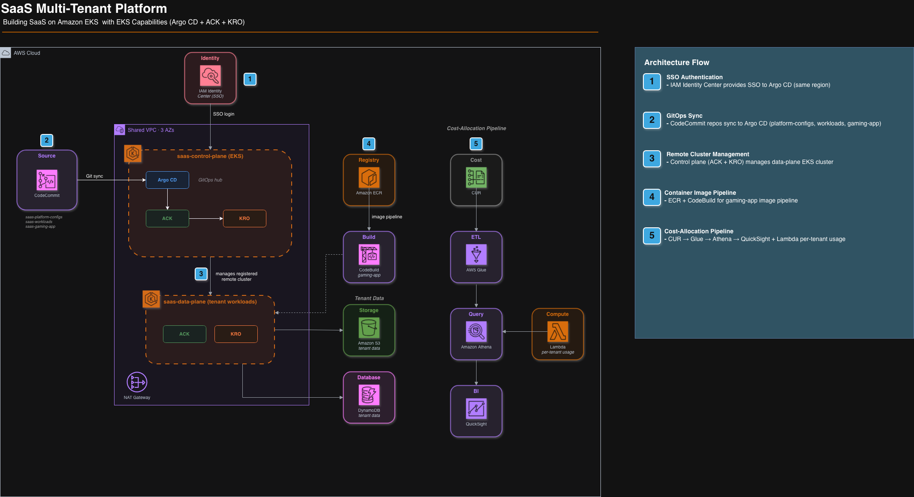

# Sample SaaS on Amazon EKS

This repository demonstrates a multi-tenant SaaS architecture built on Amazon EKS using a control plane / data plane cluster separation pattern. It leverages EKS capabilities (Argo CD, ACK, and KRO) to deliver a fully GitOps-driven platform where tenants are onboarded through simple Kubernetes manifests.

> **Workshop:** This project backs the AWS workshop **[Building SaaS on EKS](https://catalog.workshops.aws/building-saas-on-eks)**. To deploy it in your own AWS account, follow the [self-paced CloudFormation setup](https://catalog.workshops.aws/building-saas-on-eks/en-US/50-getting-started/03-self-paced-setup.md), which provisions the prerequisites before you run the Terraform in this repo.

## Overview

The solution provisions two EKS Auto Mode clusters within a shared VPC:

- **Control Plane Cluster** — Hosts platform management components and runs **Argo CD as the GitOps hub**. The control plane's Argo CD is the *only* Argo CD instance: it registers the data plane as a remote cluster and drives all deployments to it. Its ApplicationSets sync platform configurations (add-ons, resource graph definitions) and tenant workloads from CodeCommit, then deploy them to the registered data-plane cluster.
- **Data Plane Cluster** — Runs the tenant workloads (the gaming application). It is registered with the control plane's Argo CD as a remote target and does **not** run its own Argo CD.

Both clusters have the **ACK** (AWS Controllers for Kubernetes) and **KRO** (Kubernetes Resource Orchestrator) capabilities enabled, so AWS resources can be provisioned and composed natively from Kubernetes.

Tenant onboarding is as simple as committing a YAML file. A KRO `ResourceGraphDefinition` defines the `Tenant` custom resource, and each tenant instance is a lightweight manifest that selects a `tier` (`basic` or `pro`). KRO expands it into a full application stack — namespace, IAM role, network policy, quotas, the gaming Deployment/Service/Ingress, and (for `pro`) dedicated S3 + DynamoDB.

## Architecture



## Repository Structure

```
.
├── terraform/                      # Infrastructure as Code
│   ├── *.tf                        #   VPC, EKS clusters, capabilities, IAM, CodeCommit
│   ├── codebuild-gaming-app.tf     #   ECR repo + CodeBuild pipeline for the gaming app image
│   ├── cost-allocation.tf          #   CUR → Glue → Athena → QuickSight cost dashboards
│   ├── lambda/                     #   Per-tenant usage aggregator Lambda
│   ├── templates/                  #   Athena SQL views + dashboard definitions
│   └── assets/                     #   Sample CUR data
├── repository-assets/              # Content to push to CodeCommit after provisioning
│   ├── saas-platform-configs/      #   Platform configs → control plane Argo CD
│   │   ├── add-ons/                #     Add-on Helm values and IAM (e.g., KEDA)
│   │   ├── applicationsets/        #     Argo CD ApplicationSets (platform-configs, addon-manager)
│   │   └── resourceGraphs/         #     KRO ResourceGraphDefinitions
│   │       ├── tenant-main.yaml          #       defines the `Tenant` CR (tier router)
│   │       ├── tenant-basic-tier.yaml    #       basic-tier package (shared resources)
│   │       ├── tenant-pro-tier.yaml      #       pro-tier package (dedicated resources)
│   │       ├── tenant-iam-role.yaml      #       per-tenant IAM role / pod identity
│   │       ├── shared-resources.yaml     #       shared S3/DynamoDB + Karpenter NodePool
│   │       └── gaming-application.yaml   #       the gaming app Deployment/Service/Ingress
│   ├── saas-workloads/             #   Workloads → control plane Argo CD (deployed to data plane)
│   │   ├── applicationsets/        #     Argo CD ApplicationSet (tenants)
│   │   ├── tenants/                #     Live tenant manifests + cluster policies
│   │   └── examples/               #     Examples: ack/, app/, kro/, security/
│   └── saas-gaming-app/            #   Node.js/TypeScript gaming application source
```

## Prerequisites

- An AWS account with [AWS IAM Identity Center](https://docs.aws.amazon.com/singlesignon/latest/userguide/what-is.html) **already enabled**
- **The IAM Identity Center instance must be in the same AWS region as your target deployment region.** The Argo CD capability is configured with `idc_region = <deployment region>`, so an Identity Center instance in a different region will not work.
- [Terraform](https://developer.hashicorp.com/terraform/install) >= 1.3
- [AWS CLI](https://docs.aws.amazon.com/cli/latest/userguide/getting-started-install.html) v2 configured with valid credentials
- [kubectl](https://kubernetes.io/docs/tasks/tools/) installed
- [Git](https://git-scm.com/) with HTTPS credentials configured for CodeCommit
- (Optional, for local gaming-app development) [Node.js](https://nodejs.org/) 18+ and [Docker](https://www.docker.com/)

## Getting Started

### 1. Deploy the Infrastructure

```bash
cd terraform
terraform init
terraform plan
terraform apply
```

This provisions the VPC, both EKS clusters, all capabilities (ACK, Argo CD, KRO), the three CodeCommit repositories (`saas-platform-configs`, `saas-workloads`, `saas-gaming-app`), IAM resources, an Identity Center user/group for Argo CD access, the ECR repository and CodeBuild pipeline for the gaming app image, and the cost-allocation / QuickSight stack.

### 2. Push Repository Assets to CodeCommit

After Terraform completes, push the repository assets to the newly created CodeCommit repositories. Pushing `saas-gaming-app` triggers the CodeBuild pipeline, which builds and pushes the container image to ECR.

```bash
# Get clone URLs
PLATFORM_REPO=$(cd terraform && terraform output -raw platform_configs_clone_url_http)
WORKLOADS_REPO=$(cd terraform && terraform output -raw workloads_clone_url_http)
GAMING_REPO=$(cd terraform && terraform output -json gaming_app_repository | jq -r .clone_url_http)

# Initialize and push platform configs
cd repository-assets/saas-platform-configs
git init && git add . && git commit -m "Initial platform configs"
git remote add origin "$PLATFORM_REPO"
git push -u origin main

# Initialize and push workloads
cd ../saas-workloads
git init && git add . && git commit -m "Initial workloads"
git remote add origin "$WORKLOADS_REPO"
git push -u origin main

# Initialize and push the gaming app (triggers CodeBuild → ECR)
cd ../saas-gaming-app
git init && git add . && git commit -m "Initial gaming app"
git remote add origin "$GAMING_REPO"
git push -u origin main
```

### 3. Access Argo CD

Argo CD runs only on the control plane cluster. Retrieve its URL:

```bash
cd terraform

# This output prints the AWS CLI command to fetch the URL; run that command
terraform output -raw get_argocd_url_control_plane
```

**Log in via AWS IAM Identity Center SSO.** Argo CD admin access is granted to members of the `ArgoAdmins` Identity Center group; Terraform creates an `argo-admin` user (configurable) and adds it to that group. There is no password-based login.

> **Note:** Terraform still emits `get_argocd_url_data_plane` and `argo_admin_password` outputs, but these are **vestigial** — there is no data-plane Argo CD, and the generated password is not wired into login. Ignore them.

### 4. Onboard a New Tenant

Create a new `Tenant` manifest in `repository-assets/saas-workloads/tenants/`. The `tier` field selects the resource model.

**Basic tier** (shared S3 bucket and DynamoDB table, isolated by partition key):

```yaml
apiVersion: kro.run/v1alpha1
kind: Tenant
metadata:
  name: tenant-001
  labels:
    tenant-id: tenant-001
    tenant-tier: basic
    managed-by: kro
spec:
  tenantId: tenant-001
  tenantName: "Tenant Basic 001"
  tier: basic
  version: "latest"
  tenantPool: "pool-resources-001"
```

**Pro tier** (dedicated S3 bucket and DynamoDB table):

```yaml
apiVersion: kro.run/v1alpha1
kind: Tenant
metadata:
  name: tenant-004
  labels:
    tenant-id: tenant-004
    tenant-tier: pro
    managed-by: kro
spec:
  tenantId: tenant-004
  tenantName: "Tenant Pro 004"
  tier: pro
  version: "latest"
  bucketName: tenant-004-assets       # must be globally unique
  tableName: gaming-app-tenant-004
```

Commit and push to the `saas-workloads` repository. The control plane's Argo CD syncs the manifest and KRO expands the `Tenant` into the tier's full stack on the data-plane cluster. See `repository-assets/saas-workloads/examples/kro/` for more examples.

## Gaming Application

`repository-assets/saas-gaming-app/` is the multi-tenant workload that tenants run — a Node.js/TypeScript Express application with a simple web-based game, player avatars (S3), game state and leaderboards (DynamoDB), and Kubernetes health endpoints.

Its image is built by a CodeCommit → CodeBuild → ECR pipeline (`terraform/codebuild-gaming-app.tf`): pushing to the `saas-gaming-app` repository triggers CodeBuild to build the container and push it to the ECR repository, which the `Tenant` deployments reference.

See [`repository-assets/saas-gaming-app/README.md`](repository-assets/saas-gaming-app/README.md) for local development, environment variables, API endpoints, and the DynamoDB/S3 schema.

## Tenant Tiers

| | Basic | Pro |
|---|---|---|
| **S3** | Shared bucket, prefix-scoped IAM | Dedicated bucket per tenant |
| **DynamoDB** | Shared table (`gaming-app-shared`), `LeadingKeys`-scoped, composite partition keys | Dedicated table (`gaming-app-tenant-{id}`) |
| **Compute** | Shared Karpenter NodePool | Dedicated Karpenter NodePool, HPA |
| **Isolation** | Logical (partition key / IAM condition) | Physical (dedicated AWS resources) |
| **Use case** | Cost-effective for smaller tenants | Performance & isolation for larger tenants |

## Cost Allocation & Dashboards

`terraform/cost-allocation.tf` provisions a per-tenant cost pipeline: Cost and Usage Report data lands in S3, a Glue crawler indexes it, Athena views split costs, and QuickSight renders dashboards (cost overview, tenant service costs, and EKS infrastructure cost per tenant). A Lambda (`terraform/lambda/usage_aggregator.py`) runs on a 5-minute EventBridge schedule to aggregate per-tenant usage metrics used for proportional cost splitting.

Get the dashboard URL:

```bash
cd terraform
terraform output -raw quicksight_dashboard_url
```

## Key Technologies

| Technology | Role |
|-----------|------|
| [Amazon EKS Auto Mode](https://docs.aws.amazon.com/eks/latest/userguide/automode.html) | Simplified cluster management with automated node pools |
| [EKS Argo CD Capability](https://docs.aws.amazon.com/eks/latest/userguide/argocd.html) | Managed Argo CD (control plane only) for GitOps continuous delivery |
| [EKS ACK Capability](https://docs.aws.amazon.com/eks/latest/userguide/ack.html) | AWS Controllers for Kubernetes to provision cloud resources |
| [EKS KRO Capability](https://docs.aws.amazon.com/eks/latest/userguide/kro.html) | Kubernetes Resource Orchestrator for composable resource packages |
| [AWS IAM Identity Center](https://docs.aws.amazon.com/singlesignon/latest/userguide/what-is.html) | SSO authentication for Argo CD |
| [AWS CodeCommit](https://docs.aws.amazon.com/codecommit/latest/userguide/welcome.html) | Git repositories for GitOps source of truth |
| [Amazon ECR](https://docs.aws.amazon.com/AmazonECR/latest/userguide/what-is-ecr.html) + [CodeBuild](https://docs.aws.amazon.com/codebuild/latest/userguide/welcome.html) | Build and store the gaming application container image |
| [Amazon QuickSight](https://docs.aws.amazon.com/quicksight/latest/user/welcome.html) + [Athena](https://docs.aws.amazon.com/athena/latest/ug/what-is.html) + [Glue](https://docs.aws.amazon.com/glue/latest/dg/what-is-glue.html) | Per-tenant cost-allocation dashboards |
| [AWS Lambda](https://docs.aws.amazon.com/lambda/latest/dg/welcome.html) + [EventBridge](https://docs.aws.amazon.com/eventbridge/latest/userguide/eb-what-is.html) | Scheduled per-tenant usage aggregation |

## Cleanup

```bash
cd terraform
terraform destroy
```

> **Note:** `terraform destroy` may fail until some resources are emptied or torn down manually. In particular, non-empty S3 buckets (CUR data, Athena results, tenant buckets), ECR images, and the QuickSight subscription can block destruction. Empty/remove these first if destroy reports dependency errors.

## Security

See [CONTRIBUTING](CONTRIBUTING.md#security-issue-notifications) for more information.

## License

This library is licensed under the MIT-0 License. See the [LICENSE](LICENSE) file.
